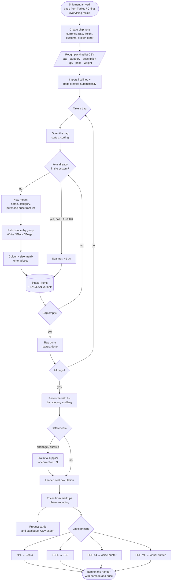
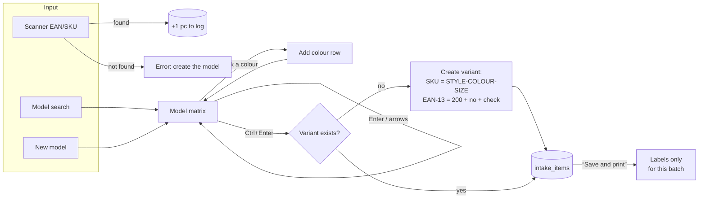
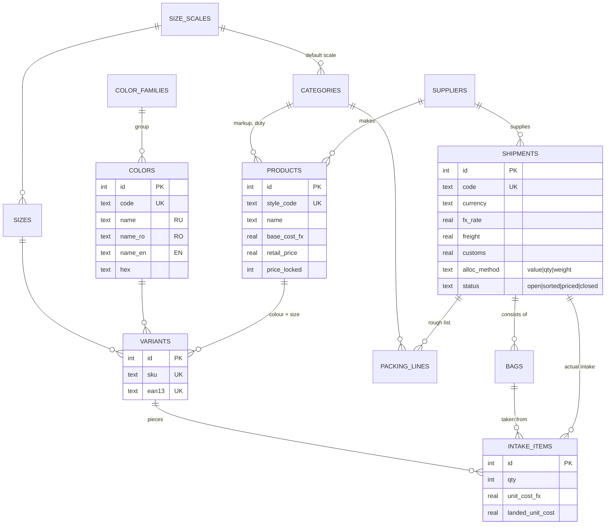
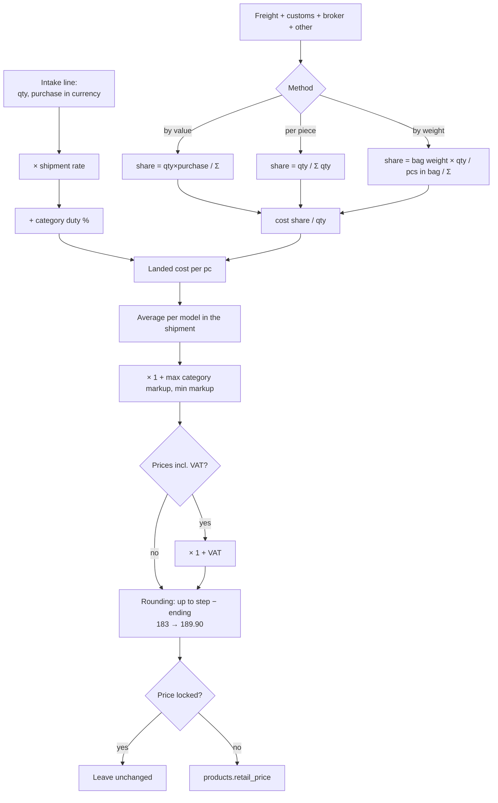
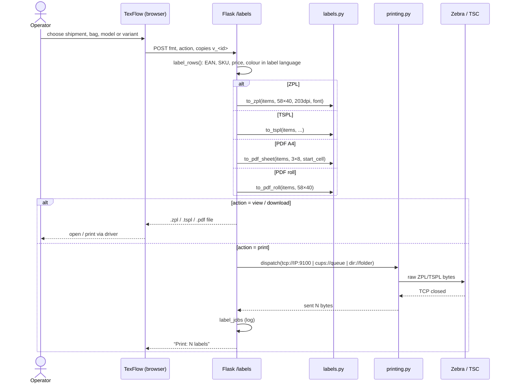
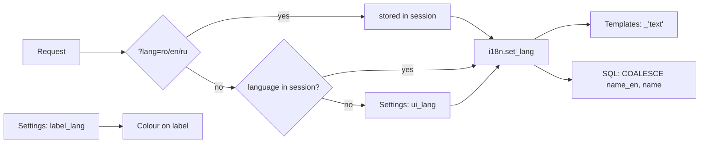

# TexFlow — flowcharts (Mermaid)

[Русский](ARCHITECTURE.md) · [Română](ARCHITECTURE.ro.md) · **English**

The diagrams render directly on GitHub, in VS Code with Mermaid support and at
https://mermaid.live. The first one is also built into the app's “Help” page
(in the interface language).

## 1. From bag to shelf

## 2. The “Sort bag” screen

## 3. Data model (ER)

The `categories`, `color_families` and `size_scales` tables also have
`name_ro` and `name_en`.

## 4. Landed cost and price

## 5. Label printing

## 6. Language selection

