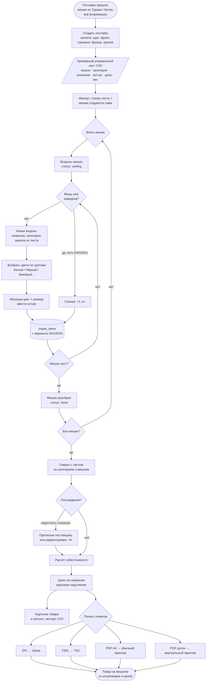
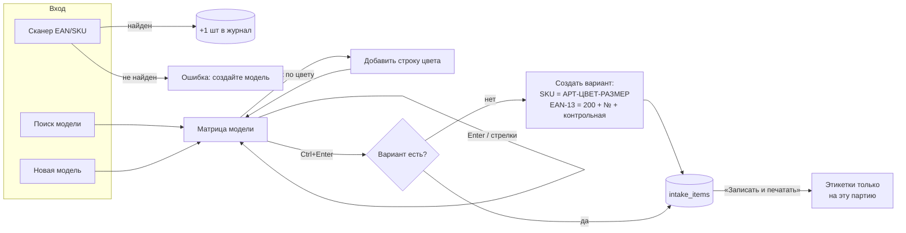
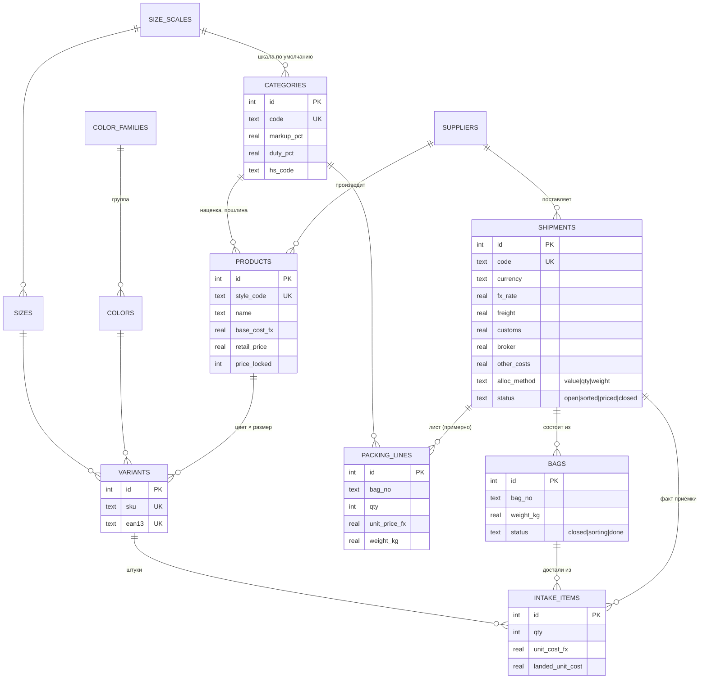
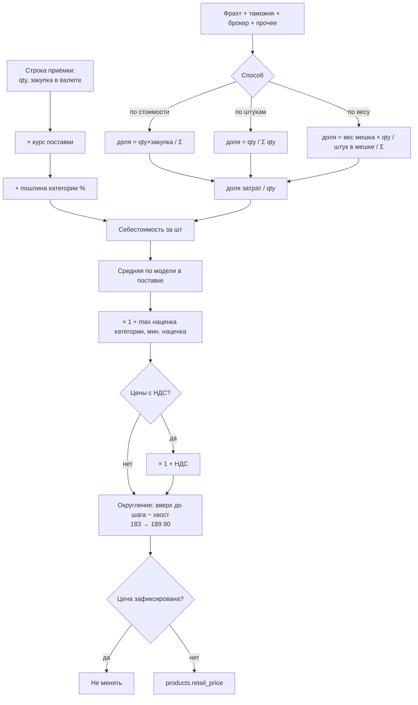
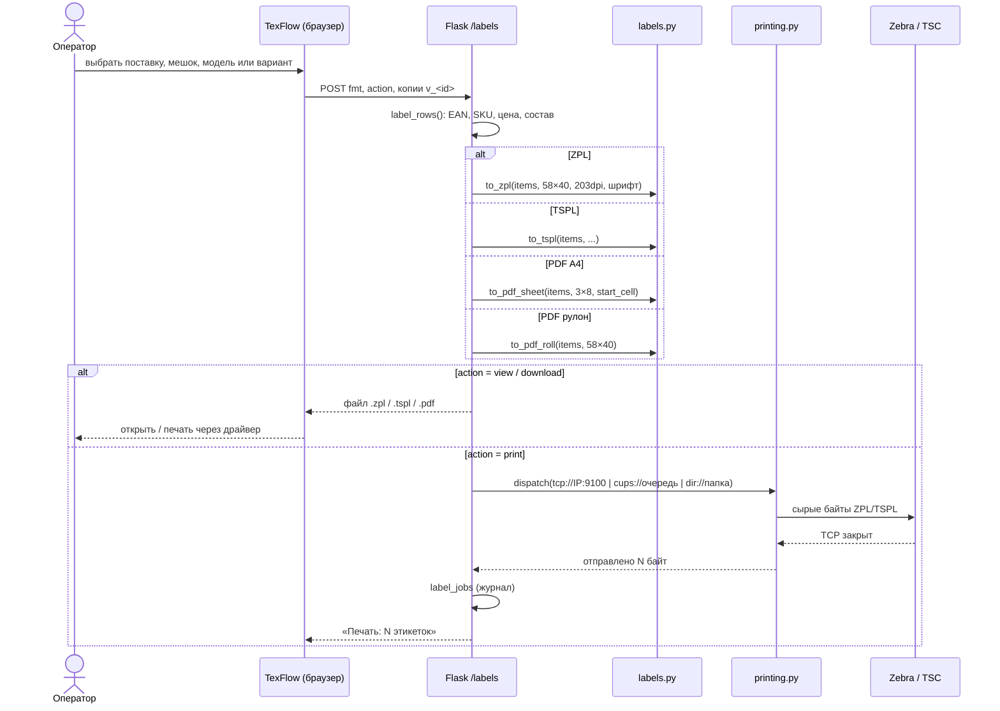
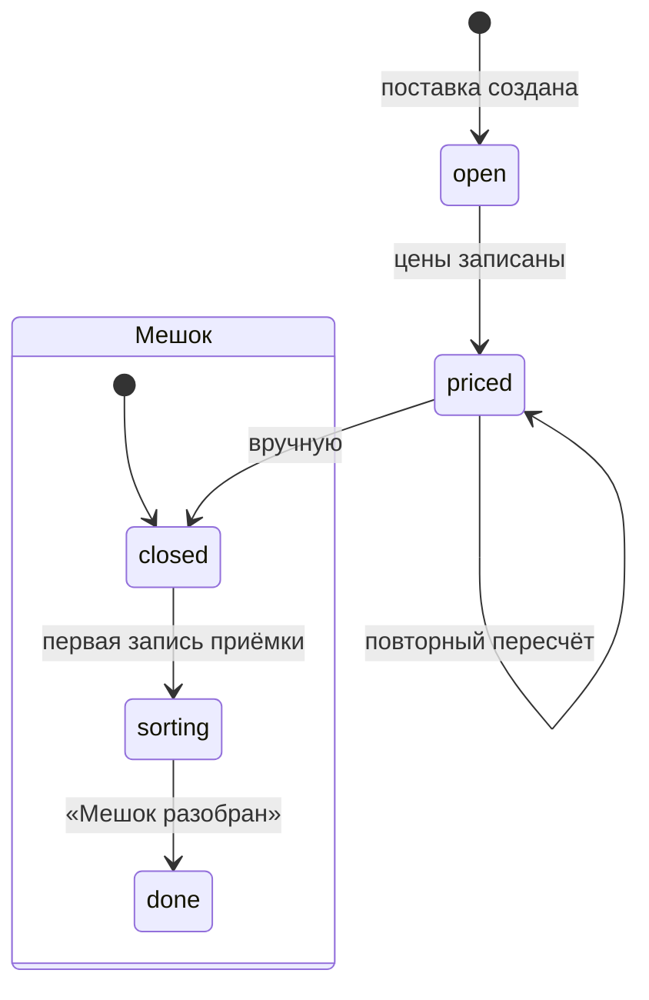

# TexFlow — блок-схемы (Mermaid)

**Русский** · [Română](ARCHITECTURE.ro.md) · [English](ARCHITECTURE.en.md)

Схемы ниже рисуются прямо на GitHub, в VS Code с поддержкой Mermaid и на
https://mermaid.live. Первая схема также встроена в страницу «Инструкция»
самого приложения.

## 1. Процесс от мешка до полки

## 2. Экран «Разбор мешка»

## 3. Модель данных (ER)

## 4. Расчёт себестоимости и цены

## 5. Печать этикеток

## 6. Статусы

