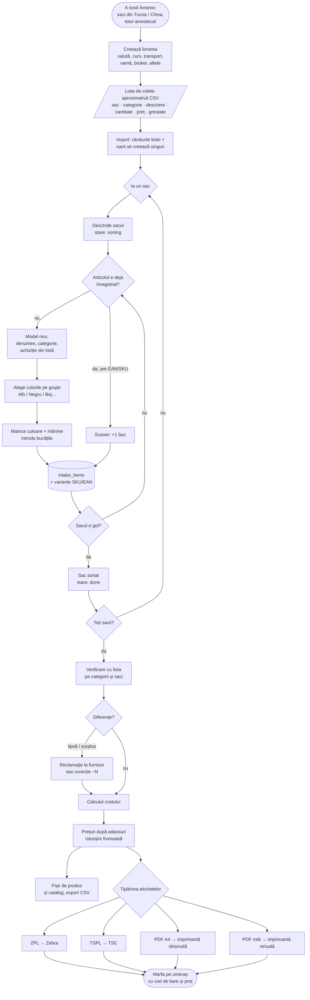
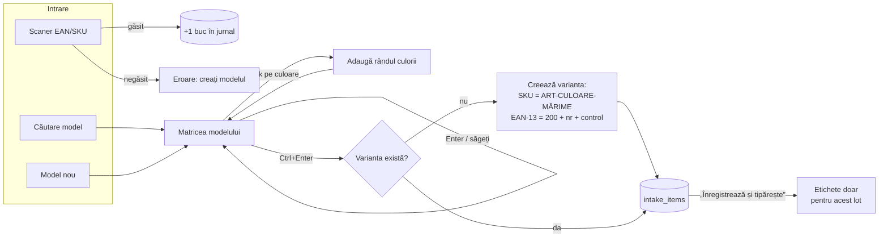
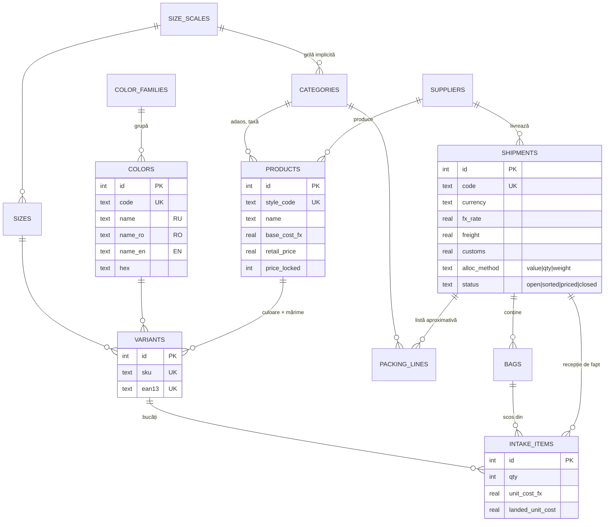
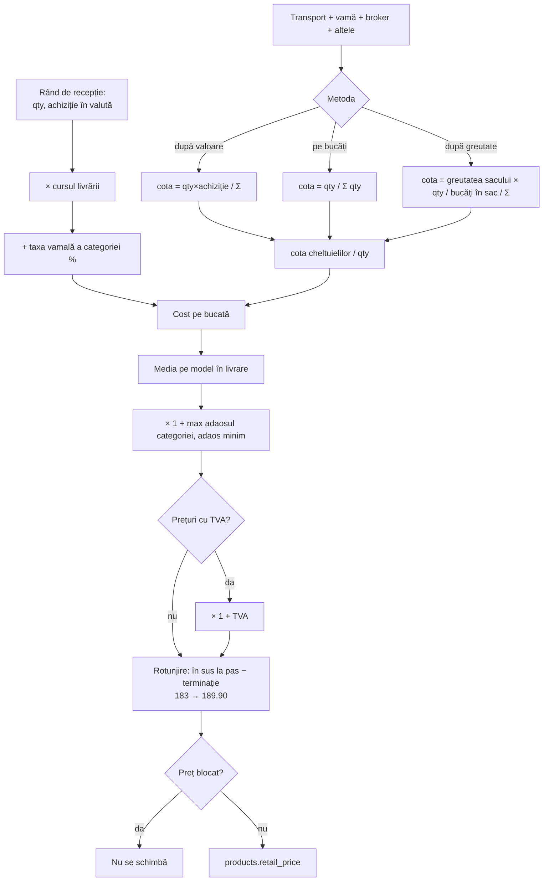
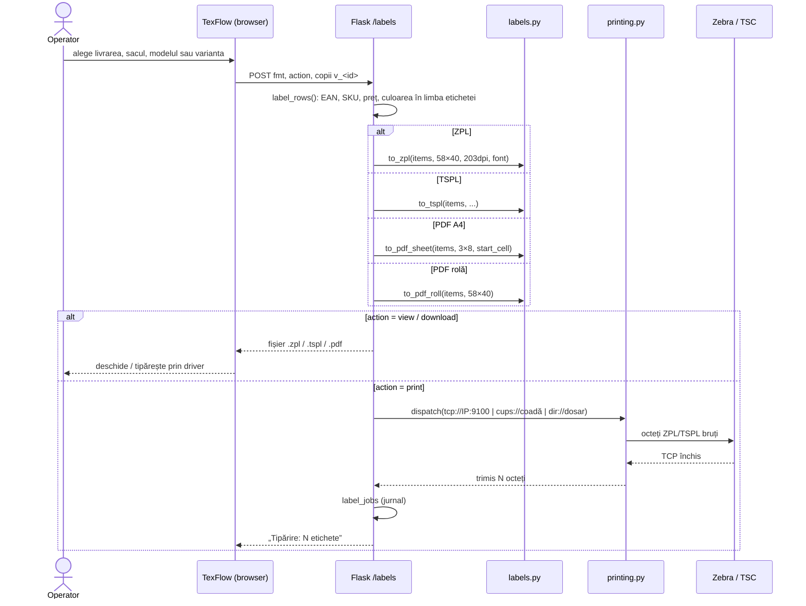
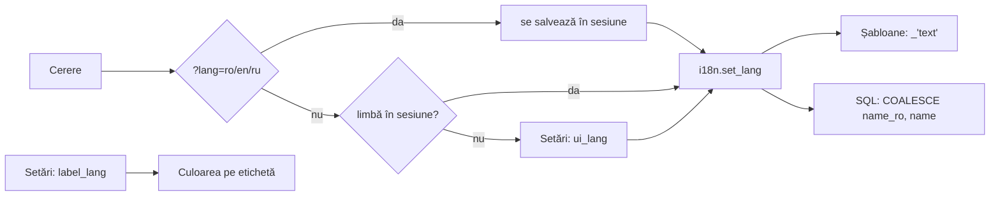

# TexFlow — scheme bloc (Mermaid)

[Русский](ARCHITECTURE.md) · **Română** · [English](ARCHITECTURE.en.md)

Schemele se afișează direct pe GitHub, în VS Code cu suport Mermaid și pe
https://mermaid.live. Prima schemă este inclusă și în pagina „Instrucțiuni” a
aplicației (în limba interfeței).

## 1. Procesul de la sac la raft

## 2. Ecranul „Sortarea sacului”

## 3. Modelul de date (ER)

Tabelele `categories`, `color_families` și `size_scales` au de asemenea
coloanele `name_ro` și `name_en`.

## 4. Calculul costului și al prețului

## 5. Tipărirea etichetelor

## 6. Alegerea limbii

