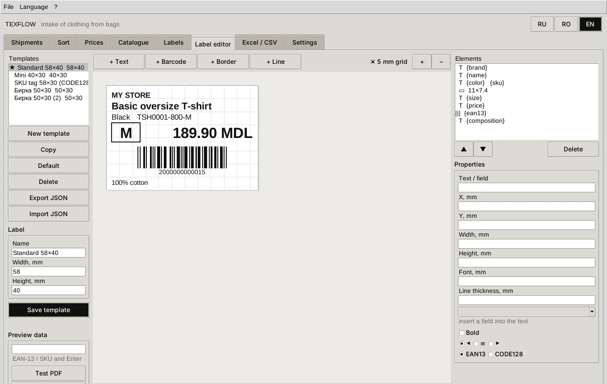

# TexFlow Desktop — native app for Windows, macOS and Linux

[Русский](DESKTOP.md) · [Română](DESKTOP.ro.md) · **English**

TexFlow Desktop is a regular windowed program (Python + Tkinter), with no browser and no server.
It shares the core with the web version:

- the same SQLite database;
- the same cost and pricing rules;
- the same ZPL / TSPL / PDF labels;
- the same RU / RO / EN translations.

Both versions can work with the same database.

What the native version has:

- every intake step: shipments, sorting bags with the matrix and the scanner, reconciliation,
  prices, catalogue, labels;
- **built-in label editor** — your own layout, with the mouse, for any label size;
- **Excel (.xlsx) and CSV export and import** — reports, prices, catalogue, intake results;
- **self-install**: double-click the setup file and the program does the rest.

## 1. Installation

### Easiest — the setup file

Unzip TexFlow and run the file for your system:

| System | File | What it does |
|---|---|---|
| Windows 10/11 | `Install-TexFlow-Windows.bat` (double-click) | finds Python 3.10+; if missing, installs Python 3.12 via `winget` (or opens python.org); then runs the installer |
| macOS 12+ | `Install-TexFlow-macOS.command` (double-click; first time: right-click → Open) | finds Python 3.10+ with Tk; if missing, opens the python.org download page; then runs the installer |
| Linux | `sh install-texflow-linux.sh` | finds Python 3.10+ with Tk and venv; if missing, prints the `apt`/`dnf`/`pacman` command (`--with-system-packages` runs it via `sudo`) |

The installer (`install/install.py`) takes five steps and needs no admin rights:

1. checks Python and Tkinter;
2. copies the program into the user's folder;
3. creates an isolated `venv` and installs `reportlab`, `openpyxl`, `flask` into it;
4. creates the **TexFlow** (app window) and **TexFlow Web** (browser) shortcuts;
5. checks the launch and opens the program.

| | Windows | macOS | Linux |
|---|---|---|---|
| Program | `%LOCALAPPDATA%\Programs\TexFlow` | `~/Applications/TexFlow` | `~/.local/lib/texflow-app` |
| Shortcuts | Start menu → TexFlow, desktop | `~/Applications/TexFlow.app`, desktop | applications menu, desktop |
| Data (database) | `%APPDATA%\TexFlow` | `~/Library/Application Support/TexFlow` | `~/.local/share/texflow` |

Data is kept apart from the program, so reinstalling and updating never touch it.

### Without installing

```bash
python texflow_app.py          # app window
python texflow_app.py --demo   # with the demo shipment
python texflow_app.py --web    # web version in the browser
python texflow_app.py --check  # check the environment
```

On first run, missing libraries install themselves into the data folder (`pylibXY`).

### Ready-made program without Python (PyInstaller)

`python install/build_exe.py` builds `dist/TexFlow-<version>-<os>-<arch>.zip`. Inside:
`TexFlow.exe` (Windows), `TexFlow.app` (macOS) or `TexFlow` (Linux), with every library bundled;
the user's computer needs no Python.

Builds must run on the target system, so GitHub Actions makes all three — **on every push** that
changes TexFlow (section 6).

### Uninstall

Use the “Uninstall TexFlow” shortcut (Windows), `uninstall-texflow` in the program folder, or
`python install/install.py --uninstall`. The database stays. To delete it too, add `--purge`.

## 2. The window

Tabs follow the order of work.

| Tab | What to do |
|---|---|
| **Shipments** | new shipment; rate and costs; packing list (CSV **or Excel**); bags; reconciliation |
| **Sort** | pick shipment and bag → scanner (repeat item +1) or “New model” → click colours → quantities in the matrix → **Ctrl+Enter** |
| **Prices** | proposal per model; double-click — own price; “Write prices to product cards” |
| **Catalogue** | search in any language, by style no., SKU, EAN; card with RO/EN translations; price lock |
| **Labels** | “Select” — every received piece of the shipment or bag; template; format; file / network printer / system printer |
| **Label editor** | your own templates — see section 3 |
| **Excel / CSV** | export and import — see section 4 |
| **Settings** | interface and label language, VAT and rounding, printers, A4 sheet |

Switch the language with the **RU / RO / EN** buttons at the top right or the Language menu. The
choice is remembered.

The sorting matrix works from the keyboard:

- **Enter** and **→** — next cell;
- **↑ ↓** — neighbouring row;
- **Ctrl+Enter** — save.

## 3. Label editor



1. **Templates** (left): New, Copy, Default (★ — used when no other is chosen), Delete,
   Export / Import JSON (to move a template to another computer).
2. **Label size** — width and height in mm; any size from 10 mm.
3. **Elements** are added with the buttons above the canvas:
   - **Text** — any text with field placeholders:
     `{brand}`, `{name}`, `{color}`, `{size}`, `{price}`, `{price_value}`, `{currency}`, `{sku}`,
     `{ean13}`, `{style}`, `{composition}`, `{origin}`. For example `{color} · {size}`;
   - **Barcode** — EAN-13 (from `{ean13}`) or CODE128 (usually `{sku}`);
   - **Box** and **Line** (horizontal, vertical, diagonal).
4. **Mouse**:
   - a click selects an element; a box is picked by clicking its outline, so it does not block
     what is inside;
   - dragging moves the element in 0.5 mm steps;
   - the blue square in the corner resizes it.

   **Arrow keys** move the selected element by 0.5 mm, **Shift+arrows** by 0.1 mm, **Delete**
   removes it.
5. **Properties** (right): text, X/Y/width/height in mm, font size, bold, alignment, line
   thickness, barcode type.
6. **Preview data**: type an item's EAN or SKU and the canvas shows its label. “Test PDF” and
   “Show ZPL / TSPL”.
7. **Save template**. The template becomes available in the Labels tab and in the web version.

The same template prints as ZPL (Zebra), TSPL (TSC), PDF roll and on the A4 sheet. The editor
canvas draws the same geometry as the printout.

## 4. Excel and CSV

**Export** (Excel / CSV tab → dataset → Excel or CSV):

- **Full report** — one Excel workbook with every sheet;
- **Catalogue** — one row per variant;
- **Prices** — for editing in Excel;
- **Shipments**;
- **Intake**;
- **Packing list**;
- **Reconciliation**;
- **Price proposal**.

You can pick one shipment or all of them.

What the files look like:

- **Excel:** bold headers, frozen first row, autofilter. EAN, SKU and style no. are stored as
  text, so Excel never turns `2000000000015` into `2E+12`.
- **CSV:** `;` separator, UTF-8 with BOM.
- **Headers** are in the interface language.

**Import**:

| What | Result |
|---|---|
| Packing list | supplier list lines and the shipment's bags |
| Catalogue | new models and variants; with a shipment chosen and “Qty” filled — straight into intake. A new size is added to the scale |
| Prices | style no. + price (and/or lock, purchase) → cards updated |
| Intake results | SKU or EAN-13, qty, bag — e.g. from a second workstation |

Headers are understood in Russian, Romanian, English and by technical name. So you can export
“Prices” in Romanian, edit them in Excel and import them back in English.

## 5. Troubleshooting

| Symptom | Fix |
|---|---|
| “Tkinter not found” | Windows/macOS — Python from python.org; Linux — `sudo apt install python3-tk python3-venv` |
| Windows: “Windows protected your PC” | “More info” → “Run anyway” |
| macOS: “developer cannot be verified” | right-click → Open |
| Cyrillic prints in Latin letters on Zebra/TSC | set the label language to **English** or load a TTF font into the printer |

## 6. Build on every push, unisim-soft signature and verification

`.github/workflows/texflow-desktop.yml` runs on **every push** to any branch that changes
`standalone/texflow/`, and on `texflow-v*` tags. The stages:

1. **tests** (pytest, including the window under Xvfb);
2. **scripts edition** `TexFlow-<version>-scripts.zip` with `MANIFEST.sha256` and the unisim-soft
   signature `MANIFEST.sha256.sig`;
3. **run from scripts** on Windows, macOS and Linux: `--verify`, `--check`, `--smoke`, the
   installer;
4. **executables**: `TexFlow.exe`, `TexFlow.app` (ad-hoc signed), Linux binary — each one
   **launched** without Python;
5. **`SHA256SUMS` + `SHA256SUMS.sig`** (Ed25519, **unisim-soft** key) plus a GitHub provenance
   attestation (Sigstore);
6. **publishing**: push to `main` → **texflow-nightly** pre-release; tag `texflow-v1.2.0` →
   versioned release.

**The unisim-soft key.**

- The private key is in the `UNISIM_SOFT_SIGNING_KEY` secret.
- The public key is built into the program and stored in `install/signing/unisim-soft.pub`.
  Fingerprint: `c5173c9670d69b5d`.

**Verification:**

```bash
python texflow_app.py --verify                 # integrity of its own files
python texflow_app.py --verify-sums SHA256SUMS # downloaded archives
TEXFLOW_STRICT_INTEGRITY=1 python texflow_app.py   # refuse to start if files were modified
```
