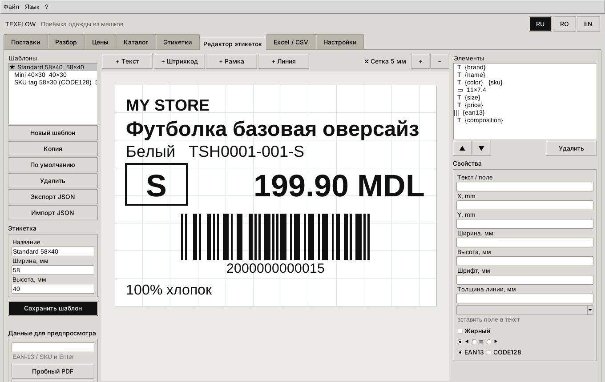

# TexFlow Desktop — нативное приложение для Windows, macOS и Linux

**Русский** · [Română](DESKTOP.ro.md) · [English](DESKTOP.en.md)

TexFlow Desktop — обычная программа с окном (Python + Tkinter), без браузера и без сервера.
Ядро у неё то же, что у веб-версии:

- та же база SQLite;
- те же правила себестоимости и цен;
- те же этикетки ZPL / TSPL / PDF;
- те же переводы RU / RO / EN.

Обе версии могут работать с одной и той же базой.

Что есть в нативной версии:

- все шаги приёмки: поставки, разбор мешков матрицей и сканером, сверка, цены, каталог, этикетки;
- **встроенный редактор этикеток** — своя раскладка, мышью, для любого размера этикетки;
- **выгрузка и загрузка Excel (.xlsx) и CSV** — отчёты, цены, каталог, результаты приёмки;
- **самоустановка**: двойной щелчок по файлу установки, остальное программа делает сама.

## 1. Установка

### Самый простой способ — файл установки

Распакуйте архив TexFlow и запустите файл для своей системы:

| Система | Файл | Что он делает |
|---|---|---|
| Windows 10/11 | `Install-TexFlow-Windows.bat` (двойной щелчок) | находит Python 3.10+; если его нет — ставит Python 3.12 через `winget` (или открывает python.org); затем запускает установщик |
| macOS 12+ | `Install-TexFlow-macOS.command` (двойной щелчок; при первом запуске — правый щелчок → «Открыть») | находит Python 3.10+ с Tk; если нет — открывает страницу загрузки python.org; затем запускает установщик |
| Linux | `sh install-texflow-linux.sh` | находит Python 3.10+ с Tk и venv; если нет — пишет команду `apt`/`dnf`/`pacman` (с `--with-system-packages` выполнит её через `sudo`) |

Установщик (`install/install.py`) делает пять шагов, права администратора ему не нужны:

1. проверяет Python и Tkinter;
2. копирует программу в папку пользователя;
3. создаёт изолированное окружение `venv` и ставит туда `reportlab`, `openpyxl`, `flask`;
4. создаёт ярлыки **TexFlow** (окно программы) и **TexFlow Web** (браузер);
5. проверяет запуск и открывает программу.

| | Windows | macOS | Linux |
|---|---|---|---|
| Программа | `%LOCALAPPDATA%\Programs\TexFlow` | `~/Applications/TexFlow` | `~/.local/lib/texflow-app` |
| Ярлыки | меню «Пуск» → TexFlow, рабочий стол | `~/Applications/TexFlow.app`, рабочий стол | меню приложений, рабочий стол |
| Данные (база) | `%APPDATA%\TexFlow` | `~/Library/Application Support/TexFlow` | `~/.local/share/texflow` |

Данные хранятся отдельно от программы, поэтому переустановка и обновление их не трогают.

### Без установки

```bash
python texflow_app.py          # окно программы
python texflow_app.py --demo   # с демо-поставкой
python texflow_app.py --web    # веб-версия в браузере
python texflow_app.py --check  # проверить окружение
```

При первом запуске недостающие библиотеки ставятся сами в папку данных (`pylibXY`).

### Готовая программа без Python (PyInstaller)

`python install/build_exe.py` собирает `dist/TexFlow-<версия>-<ос>-<arch>.zip`. Внутри
`TexFlow.exe` (Windows), `TexFlow.app` (macOS) или `TexFlow` (Linux) со всеми библиотеками;
Python на компьютере пользователя не нужен.

Собирать нужно на той системе, для которой программа. Поэтому все три сборки делает GitHub
Actions — **на каждый push** с изменениями TexFlow (раздел 6).

### Удаление

Через ярлык «Uninstall TexFlow» (Windows) или `uninstall-texflow` в папке программы, либо:
`python install/install.py --uninstall`. База при этом остаётся. Чтобы удалить и её, добавьте
`--purge`.

## 2. Окно программы

Вкладки идут в порядке работы.

| Вкладка | Что делать |
|---|---|
| **Поставки** | новая поставка; курс и затраты; загрузить упаковочный лист (CSV **или Excel**); мешки; сверка по категориям и мешкам |
| **Разбор** | выбрать поставку и мешок → сканер (повторная вещь +1) или «Новая модель» → клик по цветам → количества в матрице → **Ctrl+Enter** |
| **Цены** | предложение по каждой модели; двойной щелчок — своя цена; «Записать цены в карточки» |
| **Каталог** | поиск по названию на любом языке, артикулу, SKU, EAN; карточка с переводами RO/EN; фиксация цены |
| **Этикетки** | «Выбрать» — все принятые штуки поставки или мешка; шаблон; формат; файл / сетевой принтер / системный принтер |
| **Редактор этикеток** | свои шаблоны — см. раздел 3 |
| **Excel / CSV** | выгрузка и загрузка — см. раздел 4 |
| **Настройки** | язык интерфейса и этикетки, НДС и округление, принтеры, лист A4 |

Язык переключается кнопками **RU / RO / EN** вверху справа или в меню «Язык». Выбор запоминается.

Матрица разбора работает с клавиатуры:

- **Enter** и **→** — следующая ячейка;
- **↑ ↓** — соседняя строка;
- **Ctrl+Enter** — записать.

Сканер работает в режиме клавиатуры: код вводится в поле «Сканер», и по Enter вещь принята.

## 3. Редактор этикеток



1. **Шаблоны** (слева): «Новый шаблон», «Копия», «По умолчанию» (★ — им печатают, если не выбран
   другой), «Удалить», «Экспорт / Импорт JSON» (перенести шаблон на другой компьютер).
2. **Размер** этикетки — ширина и высота в мм; любой размер от 10 мм.
3. **Элементы** добавляются кнопками над холстом:
   - **Текст** — любой текст с подстановками полей:
     `{brand}`, `{name}`, `{color}`, `{size}`, `{price}`, `{price_value}`, `{currency}`, `{sku}`,
     `{ean13}`, `{style}`, `{composition}`, `{origin}`. Например `{color} · {size}`;
   - **Штрихкод** — EAN-13 (по `{ean13}`) или CODE128 (обычно по `{sku}`);
   - **Рамка** и **Линия** (горизонтальная, вертикальная, наклонная).
4. **Мышью**:
   - щелчок выделяет элемент; рамка выделяется щелчком по контуру, чтобы не мешать тому, что внутри;
   - перетаскивание двигает элемент с шагом 0.5 мм;
   - синий квадрат в углу меняет размер.

   **Стрелки** двигают выделенный элемент на 0.5 мм, **Shift+стрелки** — на 0.1 мм, **Delete** удаляет его.
5. **Свойства** (справа): текст, X/Y/ширина/высота в мм, размер шрифта, жирный, выравнивание,
   толщина линии, тип штрихкода. Поле подставляется из списка «вставить поле в текст».
6. **Данные для предпросмотра**: введите EAN или SKU вещи — холст покажет её этикетку.
   «Пробный PDF» откроет этикетку в PDF, «Показать ZPL / TSPL» — код для принтера.
7. **Сохранить шаблон**. После этого шаблон доступен на вкладке «Этикетки» и в веб-версии.

Один и тот же шаблон печатается в ZPL (Zebra), TSPL (TSC), PDF-рулон и на лист A4: ячейки
листа задаются в настройках, этикетка встаёт по центру ячейки. Холст редактора рисует ту же
геометрию, что и печать.

Стандартных шаблонов три: `Standard 58×40`, `Mini 40×30`, `SKU tag 58×30 (CODE128)`.

## 4. Excel и CSV

**Выгрузка** (вкладка «Excel / CSV» → набор данных → Excel или CSV):

| Набор | Что внутри |
|---|---|
| Полный отчёт | одна книга Excel со всеми листами ниже |
| Каталог | вариант = строка: артикул, название RU/RO/EN, категория, цвет и группа, размер, SKU, EAN-13, цена, остаток, состав |
| Цены | артикул, название, категория, закупка, цена, фиксация — **для правки в Excel** |
| Поставки | поставщик, валюта, курс, статус, штук, товар, затраты, себестоимость |
| Приёмка | время, поставка, мешок, SKU, EAN, модель, цвет, размер, шт, закупка, себестоимость |
| Упаковочный лист | строки листа поставщика |
| Сверка | по категориям и мешкам: по листу, факт, разница, статус |
| Предложение цен | себестоимость, наценка, предложенная цена, фактическая наценка |

Можно выбрать одну поставку или все сразу.

Как устроены файлы:

- **Excel:** заголовки жирные, первая строка закреплена, автофильтр. Колонки EAN, SKU и артикул
  записаны как текст, поэтому Excel не превращает `2000000000015` в `2E+12`.
- **CSV:** разделитель `;`, кодировка UTF-8 с BOM, открывается в Excel двойным щелчком.
- **Язык заголовков** — язык интерфейса.

**Загрузка**:

| Что | Колонки | Результат |
|---|---|---|
| Упаковочный лист | мешок, категория, описание, кол-во, цена, вес | строки листа и мешки поставки |
| Каталог | артикул, название (RO/EN), категория, код цвета, размер, [кол-во, закупка, цена] | новые модели и варианты; если выбрана поставка и есть «Кол-во» — сразу в приёмку. Нового размера нет в шкале — добавится. Ошибки строк перечисляются |
| Цены | артикул + цена (и/или фиксация, закупка) | обновлены карточки; неизвестные артикулы перечислены |
| Результаты приёмки | SKU или EAN-13, кол-во, мешок | штуки добавлены в поставку — например, со второго рабочего места |

Заголовки колонок понимаются на русском, румынском, английском и по техническому имени
(`style_code`, `qty`…). Поэтому порядок такой: выгрузите «Цены» на румынском, поправьте в Excel,
загрузите обратно на русском.

## 5. Если что-то не так

| Симптом | Что делать |
|---|---|
| «Tkinter не найден» | Windows/macOS — поставить Python с python.org; Linux — `sudo apt install python3-tk python3-venv` |
| Windows: «Windows защитила компьютер» на .bat | «Подробнее» → «Выполнить в любом случае» (файл не подписан) |
| macOS: «невозможно проверить разработчика» | правый щелчок → «Открыть»; установщик снимает карантин с папки |
| Кириллица на Zebra/TSC печатается латиницей | так задумано для встроенных шрифтов принтера; для кириллицы загрузите TTF в принтер и укажите его в «Настройках» |
| Перенести данные на другой компьютер | скопировать папку данных (таблица в разделе 1) или «Полный отчёт» Excel |

## 6. Сборка на каждый push, подпись unisim-soft и проверка

Сборку делает `.github/workflows/texflow-desktop.yml`. Он запускается на **каждый push** в любую
ветку, если изменились файлы `standalone/texflow/`, и на теги `texflow-v*`.

| Этап | Что делает |
|---|---|
| Тесты | pytest, включая окно программы в Xvfb |
| Скриптовая версия | `TexFlow-<версия>-scripts.zip`: все файлы, `MANIFEST.sha256` (SHA-256 каждого файла) и `MANIFEST.sha256.sig` — подпись unisim-soft |
| Запуск из скриптов | на Windows, macOS и Linux: проверка подписи (`--verify`), самоустановка библиотек (`--check`), окно со всеми вкладками на 3 языках (`--smoke`), установщик и запуск установленной программы |
| Сборка исполняемых файлов | `TexFlow.exe` (Windows), `TexFlow.app` (macOS, ad-hoc подпись `codesign`), бинарник Linux. Каждый **запускается** без Python (`--smoke`) |
| Подпись выпуска | `SHA256SUMS` всех архивов + `SHA256SUMS.sig` (Ed25519, ключ **unisim-soft**) + аттестация происхождения GitHub (Sigstore) |
| Выпуск | push в `main` → предварительный выпуск **texflow-nightly** (обновляется); тег `texflow-v1.2.0` → выпуск версии; любая ветка → артефакты запуска |

**Ключ unisim-soft.**

- Закрытый ключ хранится в секрете репозитория `UNISIM_SOFT_SIGNING_KEY`
  (Settings → Secrets and variables → Actions).
- Открытый ключ зашит в программу (`texflow/integrity.py`) и лежит в
  `install/signing/unisim-soft.pub`. Отпечаток: `c5173c9670d69b5d`.
- Без секрета сборка проходит, но не подписывается, и в журнале запуска появляется
  предупреждение. Для тегов выпуска подпись обязательна.
- Новая пара ключей: `python tools/release.py keygen`.

**Самопроверка программы.** Скриптовая версия при каждом запуске сверяет свои файлы с
подписанным манифестом:

```bash
python texflow_app.py --verify                 # целостность: ok · 202 файлов · подпись unisim-soft (c5173c9670d69b5d)
python texflow_app.py --verify-sums SHA256SUMS # проверить скачанные архивы
TEXFLOW_STRICT_INTEGRITY=1 python texflow_app.py   # отказаться запускаться, если файлы изменены
```

- Изменённый файл — предупреждение при запуске (в строгом режиме программа не запустится).
- Подменённый архив — `MISMATCH`.
- Изменённый `SHA256SUMS` — `подпись: INVALID`.
- Подпись проверяется кодом на чистом Python (Ed25519, RFC 8032), поэтому проверка работает
  везде, где работает сама программа.
- Аттестация происхождения GitHub (Sigstore) — дополнительно к подписи. GitHub даёт её только
  публичным репозиториям и на тарифе Enterprise; в приватном репозитории шаг пропускается с
  предупреждением. Проверка: `gh attestation verify TexFlow-…zip --repo PavelTuhari/Artgranit`.
