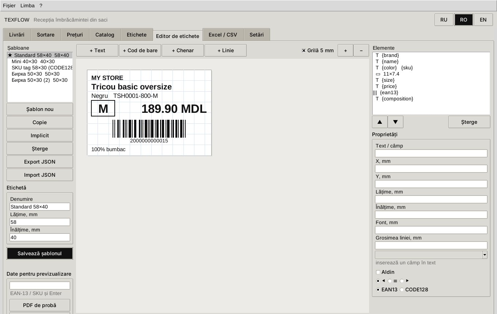

# TexFlow Desktop — aplicație nativă pentru Windows, macOS și Linux

[Русский](DESKTOP.md) · **Română** · [English](DESKTOP.en.md)

TexFlow Desktop este un program obișnuit cu fereastră (Python + Tkinter), fără browser și fără
server. Nucleul este același ca la versiunea web:

- aceeași bază SQLite;
- aceleași reguli de cost și preț;
- aceleași etichete ZPL / TSPL / PDF;
- aceleași traduceri RU / RO / EN.

Ambele versiuni pot lucra cu aceeași bază de date.

Ce are versiunea nativă:

- toți pașii recepției: livrări, sortarea sacilor cu matricea și scanerul, verificare, prețuri,
  catalog, etichete;
- **editor de etichete integrat** — aranjament propriu, cu mouse-ul, pentru orice dimensiune;
- **export și import Excel (.xlsx) și CSV** — rapoarte, prețuri, catalog, rezultatele recepției;
- **autoinstalare**: dublu clic pe fișierul de instalare, restul face programul.

## 1. Instalare

### Cel mai simplu — fișierul de instalare

Dezarhivați TexFlow și rulați fișierul pentru sistemul dvs.:

| Sistem | Fișier | Ce face |
|---|---|---|
| Windows 10/11 | `Install-TexFlow-Windows.bat` (dublu clic) | găsește Python 3.10+; dacă lipsește — instalează Python 3.12 prin `winget` (sau deschide python.org); apoi rulează instalatorul |
| macOS 12+ | `Install-TexFlow-macOS.command` (dublu clic; prima dată — clic dreapta → „Deschide”) | găsește Python 3.10+ cu Tk; dacă lipsește — deschide pagina de descărcare python.org; apoi rulează instalatorul |
| Linux | `sh install-texflow-linux.sh` | găsește Python 3.10+ cu Tk și venv; dacă lipsesc — afișează comanda `apt`/`dnf`/`pacman` (cu `--with-system-packages` o rulează prin `sudo`) |

Instalatorul (`install/install.py`) face cinci pași, fără drepturi de administrator:

1. verifică Python și Tkinter;
2. copiază programul în dosarul utilizatorului;
3. creează mediul izolat `venv` și instalează în el `reportlab`, `openpyxl`, `flask`;
4. creează scurtăturile **TexFlow** (fereastra programului) și **TexFlow Web** (browser);
5. verifică pornirea și deschide programul.

| | Windows | macOS | Linux |
|---|---|---|---|
| Program | `%LOCALAPPDATA%\Programs\TexFlow` | `~/Applications/TexFlow` | `~/.local/lib/texflow-app` |
| Scurtături | meniul Start → TexFlow, desktop | `~/Applications/TexFlow.app`, desktop | meniul de aplicații, desktop |
| Date (baza) | `%APPDATA%\TexFlow` | `~/Library/Application Support/TexFlow` | `~/.local/share/texflow` |

Datele sunt separate de program, de aceea reinstalarea și actualizarea nu le ating.

### Fără instalare

```bash
python texflow_app.py          # fereastra programului
python texflow_app.py --demo   # cu livrarea demo
python texflow_app.py --web    # versiunea web în browser
python texflow_app.py --check  # verificarea mediului
```

La prima pornire bibliotecile lipsă se instalează singure în dosarul de date (`pylibXY`).

### Program gata făcut, fără Python (PyInstaller)

`python install/build_exe.py` creează `dist/TexFlow-<versiune>-<os>-<arch>.zip`. În interior:
`TexFlow.exe` (Windows), `TexFlow.app` (macOS) sau `TexFlow` (Linux), cu toate bibliotecile;
pe calculatorul utilizatorului nu e nevoie de Python.

Construcția se face pe sistemul-țintă. Pentru toate trei deodată există un șablon pentru GitHub
Actions: `install/github-actions-texflow-desktop.yml`. Copiați-l în `.github/workflows/`, apoi
Actions → TexFlow Desktop → Run workflow.

### Dezinstalare

Prin scurtătura „Uninstall TexFlow” (Windows) sau `uninstall-texflow` din dosarul programului, ori:
`python install/install.py --uninstall`. Baza de date rămâne. Ca s-o ștergeți și pe ea, adăugați
`--purge`.

## 2. Fereastra programului

Filele urmează ordinea de lucru.

| Filă | Ce faceți |
|---|---|
| **Livrări** | livrare nouă; curs și cheltuieli; listă de colete (CSV **sau Excel**); saci; verificare |
| **Sortare** | livrarea și sacul → scaner (articol repetat +1) sau „Model nou” → clic pe culori → cantități în matrice → **Ctrl+Enter** |
| **Prețuri** | propunere pe model; dublu clic — preț propriu; „Înregistrează prețurile în fișe” |
| **Catalog** | căutare în orice limbă, după articol, SKU, EAN; fișa cu traduceri RO/EN; blocarea prețului |
| **Etichete** | „Alege” — toate bucățile recepționate ale livrării sau sacului; șablon; format; fișier / imprimantă de rețea / imprimanta de sistem |
| **Editor de etichete** | șabloane proprii — vezi secțiunea 3 |
| **Excel / CSV** | export și import — vezi secțiunea 4 |
| **Setări** | limba interfeței și a etichetei, TVA și rotunjire, imprimante, coala A4 |

Limba se schimbă cu butoanele **RU / RO / EN** din dreapta sus sau din meniul „Limba” și se
memorează.

Matricea de sortare funcționează de la tastatură:

- **Enter** și **→** — celula următoare;
- **↑ ↓** — rândul vecin;
- **Ctrl+Enter** — înregistrează.

## 3. Editorul de etichete



1. **Șabloane** (stânga): „Șablon nou”, „Copie”, „Implicit” (★ — cu el se tipărește dacă nu e ales
   altul), „Șterge”, „Export / Import JSON” (mutarea șablonului pe alt calculator).
2. **Dimensiunea** etichetei — lățime și înălțime în mm; orice dimensiune de la 10 mm.
3. **Elementele** se adaugă cu butoanele de deasupra pânzei:
   - **Text** — orice text cu câmpuri:
     `{brand}`, `{name}`, `{color}`, `{size}`, `{price}`, `{price_value}`, `{currency}`, `{sku}`,
     `{ean13}`, `{style}`, `{composition}`, `{origin}`. De exemplu `{color} · {size}`;
   - **Cod de bare** — EAN-13 (după `{ean13}`) sau CODE128 (de obicei după `{sku}`);
   - **Chenar** și **Linie** (orizontală, verticală, oblică).
4. **Cu mouse-ul**:
   - clicul selectează elementul; chenarul se selectează cu clic pe contur, ca să nu blocheze ce e
     înăuntru;
   - tragerea mută elementul cu pasul 0.5 mm;
   - pătratul albastru din colț schimbă dimensiunea.

   **Săgețile** mută elementul selectat cu 0.5 mm, **Shift+săgeți** — cu 0.1 mm, **Delete** îl
   șterge.
5. **Proprietăți** (dreapta): text, X/Y/lățime/înălțime în mm, font, aldin, aliniere, grosimea
   liniei, tipul codului de bare.
6. **Date pentru previzualizare**: introduceți EAN sau SKU — pânza arată eticheta acelui articol.
   „PDF de probă” și „Arată ZPL / TSPL”.
7. **Salvează șablonul**. Șablonul devine disponibil în fila „Etichete” și în versiunea web.

Același șablon se tipărește în ZPL (Zebra), TSPL (TSC), PDF rolă și pe coala A4. Pânza
editorului desenează aceeași geometrie ca tipărirea.

## 4. Excel și CSV

**Export** (fila „Excel / CSV” → setul de date → Excel sau CSV):

- **Raport complet** — o singură carte Excel cu toate foile;
- **Catalog** — un rând pe variantă;
- **Prețuri** — pentru editare în Excel;
- **Livrări**;
- **Recepție**;
- **Listă de colete**;
- **Verificare**;
- **Propunere de prețuri**.

Se poate alege o livrare sau toate.

Cum arată fișierele:

- **Excel:** antete aldine, primul rând fixat, autofiltru. EAN, SKU și articolul sunt salvate ca
  text, ca Excel să nu transforme `2000000000015` în `2E+12`.
- **CSV:** separator `;`, UTF-8 cu BOM.
- **Antetele** sunt în limba interfeței.

**Import**:

| Ce | Rezultat |
|---|---|
| Listă de colete | rândurile listei furnizorului și sacii livrării |
| Catalog | modele și variante noi; dacă e aleasă livrarea și există „Cantitate” — direct în recepție. O mărime nouă se adaugă în grilă |
| Prețuri | articol + preț (și/sau blocare, achiziție) → fișele se actualizează |
| Rezultatele recepției | SKU sau EAN-13, cantitate, sac — de exemplu de la al doilea post de lucru |

Antetele sunt înțelese în rusă, română, engleză și după numele tehnic. Puteți exporta „Prețuri”
în română, corecta în Excel și importa înapoi.

## 5. Probleme

| Simptom | Ce faceți |
|---|---|
| „Tkinter nu a fost găsit” | Windows/macOS — Python de pe python.org; Linux — `sudo apt install python3-tk python3-venv` |
| Windows: „Windows a protejat calculatorul” | „Mai multe informații” → „Rulează oricum” |
| macOS: „dezvoltatorul nu poate fi verificat” | clic dreapta → „Deschide” |
| Chirilica pe Zebra/TSC apare cu litere latine | puneți limba etichetei **Română** sau încărcați un font TTF în imprimantă |
